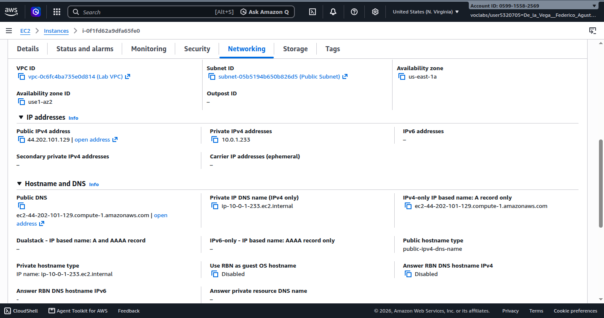
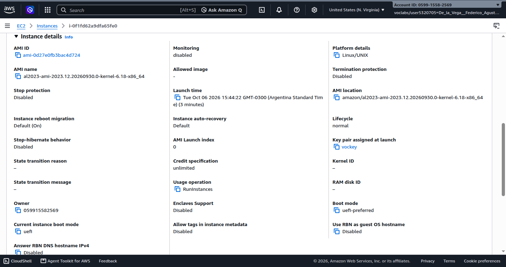
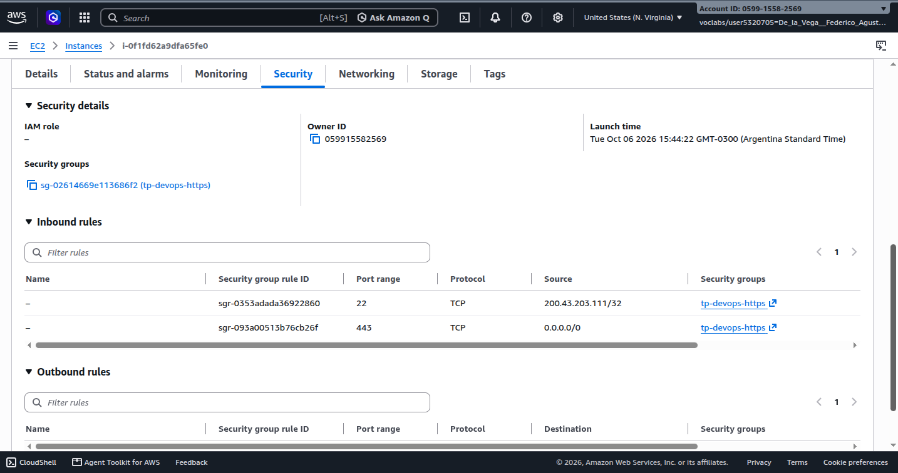

# Configuración de AWS EC2

Documentación de la instancia utilizada para desplegar el trabajo práctico. Los datos corresponden a la última sesión de pruebas del 6 de octubre de 2026.

## Resumen de la instancia

| Dato | Valor |
|---|---|
| Nombre | `tp-devops-2026-ec2` |
| Instance ID | `i-0f1fd62a9dfa65fe0` |
| Región observada | `us-east-1` |
| IPv4 pública | `44.202.101.129` |
| Tipo de instancia | `t3.medium` |

El nombre y el ID de la instancia se observan en las capturas de la consola de AWS. La IP pública se validó durante la última sesión mediante las solicitudes HTTPS incluidas en este documento.

## Sistema operativo

| Dato | Valor |
|---|---|
| Sistema operativo | Amazon Linux 2023 |

## Red

| Dato | Valor |
|---|---|
| VPC ID | `vpc-0c6fc4ba735e0d814` (Lab VPC) |
| Resolución DNS | Habilitada |
| Nombres de host DNS | Habilitados |
| Subnet ID | `subnet-05b5194b650b826d5` (Public Subnet) |
| Availability Zone | `us-east-1a` (`use1-az2`) |
| Asignación automática de IPv4 pública | Sí |
| Estado de la subnet | Disponible |

## Security Group

Security Group asociado: `tp-devops-https` (`sg-02614669e113686f2`).

### Reglas de entrada

| Rule ID | Puerto | Protocolo | Origen | Uso |
|---|---:|---|---|---|
| `sgr-0353adada36922860` | 22 | TCP | `200.43.203.111/32` | SSH únicamente desde la IP autorizada |
| `sgr-093a00513b76cb26f` | 443 | TCP | `0.0.0.0/0` | HTTPS público |

El puerto **80 no está abierto**: no existe una regla de entrada que lo permita.

### Reglas de salida

| Rule ID | Puerto | Protocolo | Destino | Descripción |
|---|---|---|---|---|
| `sgr-03e4df737e76da66` | Todo | Todo | `0.0.0.0/0` | — |

## Conexión SSH

La instancia se administró desde Windows con OpenSSH usando el usuario `ec2-user` y la clave privada `vockey.pem`:

```bat
ssh -i "D:\vockey.pem" ec2-user@44.202.101.129
```

Antes de conectarse, se corrigieron con `icacls` los permisos excesivamente abiertos del archivo `.pem` en Windows.

## Preparación de la instancia

Se instaló Docker en Amazon Linux 2023 usando el gestor de paquetes `dnf`:

```bash
sudo dnf update -y
sudo dnf install -y docker
```

Luego se habilitó el servicio y se verificaron Docker y Docker Compose:

```bash
sudo systemctl enable --now docker
docker --version
docker compose version
```

El usuario `ec2-user` inicialmente no tenía permiso para usar el socket de Docker. Se lo agregó al grupo `docker` y se cerró y volvió a abrir la sesión SSH para aplicar el cambio:

```bash
sudo usermod -aG docker $USER
```

Finalmente, se autenticó Docker Hub con `docker login`, utilizando el usuario de Docker Hub y un Personal Access Token. No se almacenaron credenciales en el repositorio.

## Copia de archivos de configuración

Los archivos `.env` se copiaron al directorio `/home/ec2-user/tp-grupo16/`:

```bat
scp -i "D:\vockey.pem" D:\Descargas\*.env ec2-user@44.202.101.129:/home/ec2-user/tp-grupo16/
```

También se copió la carpeta `init-scripts`:

```bat
scp -r -i "D:\vockey.pem" "D:\Descargas\init-scripts" ec2-user@44.202.101.129:/home/ec2-user/tp-grupo16/
```

La captura de la instancia confirma la presencia de los archivos `.env`, `docker-compose.yml` e `init-scripts` en ese directorio.

## Verificación del despliegue por HTTPS

La publicación se verificó contra la IPv4 pública mediante HTTPS. Se utilizó `-k` por el certificado TLS empleado durante la prueba:

```bash
curl -k https://44.202.101.129/
curl -k https://44.202.101.129/api/clientes
curl -k https://44.202.101.129/api/pagos
curl -k https://44.202.101.129/api/facturas
curl -k https://44.202.101.129/api/transacciones
curl -k https://44.202.101.129/api/tarjetas
```

Las capturas muestran respuestas para la página principal y para todos los endpoints listados. El contenedor `web` expone el puerto `443` de la instancia; el puerto `80` permanece sin una regla de entrada en el Security Group.

## Capturas de configuración

### Detalle de red de la VPC y Subnet

La información de red corresponde a la Lab VPC (`vpc-0c6fc4ba735e0d814`) y la subnet pública (`subnet-05b5194b650b826d5`).



### Instancia EC2 asociada

La captura identifica la instancia `i-0f1fd62a9dfa65fe0` (`tp-devops-2026-ec2`).


### Detalles de la instancia

La captura muestra la AMI seleccionada y el par de claves `vockey` asignado.



### Reglas de entrada y salida del Security Group

La captura muestra las reglas de entrada documentadas: SSH restringido y HTTPS público, así como las reglas de salida.


