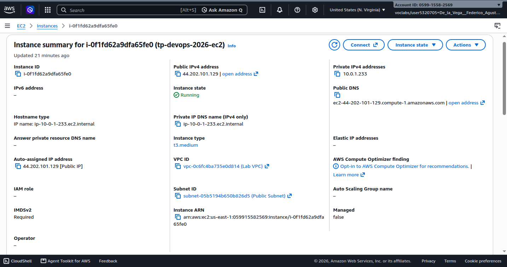

# ☁️ AWS EC2 Cloud Infrastructure & Deployment Specification

[-FF9900?logo=amazonec2&logoColor=white)](https://aws.amazon.com/ec2/)
[](https://aws.amazon.com/linux/amazon-linux-2023/)
[](https://aws.amazon.com/vpc/)

This document provides the infrastructure specification, network topology, security perimeter definitions, and provisioning runbook for the **FinTech Nova** distributed platform deployed on Amazon Web Services (AWS).

---

## 📌 Instance Provisioning Summary

| Parameter | Value | Operational Details |
|---|---|---|
| **Instance Identifier** | `tp-devops-2026-ec2` | Tagged production test instance |
| **Instance ID** | `i-0f1fd62a9dfa65fe0` | AWS EC2 managed resource |
| **AWS Region & AZ** | `us-east-1` (`us-east-1a` / `use1-az2`) | High-availability tier US East |
| **Public IPv4 Address** | `44.202.101.129` | Public endpoint for HTTPS gateway |
| **Instance Type** | `t3.medium` | 2 vCPUs (Burstable), 4 GiB Memory |
| **Operating System** | **Amazon Linux 2023 (AL2023)** | Kernel 6.1, x86_64 architecture |
| **Virtualization** | HVM | EBS-backed root volume |

---

## 🌐 Network & VPC Topology

The deployment resides inside a dedicated Virtual Private Cloud (VPC) configured with automatic public IP routing and enabled DNS resolution.

| Network Property | Value | Notes |
|---|---|---|
| **VPC ID** | `vpc-0c6fc4ba735e0d814` | Isolated virtual network |
| **Subnet ID** | `subnet-05b5194b650b826d5` | Public Subnet (`172.31.0.0/20`) |
| **DNS Resolution** | **Enabled** | Internal AWS Route 53 resolution active |
| **DNS Hostnames** | **Enabled** | Public/Private DNS records generated |
| **IPv4 Public Auto-Assign** | **Yes** | Automatic routing table attachment |
| **Route Table Association** | Internet Gateway Attached | Direct egress/ingress routing |

---

## 🔒 Security Perimeter (Security Group)

The host instance is protected by a dedicated Security Group: `tp-devops-https` (`sg-02614669e113686f2`).

### Inbound Rules (Ingress)

| Rule ID | Protocol | Port Range | Source / CIDR | Purpose & Security Rationale |
|---|---|---:|---|---|
| `sgr-0353adada36922860` | TCP | `22` | `200.43.203.111/32` | **Hardened SSH Administration**: Restricted strictly to authorized administrative CIDR mask. |
| `sgr-093a00513b76cb26f` | TCP | `443` | `0.0.0.0/0` | **Public HTTPS Gateway**: Exposes NGINX reverse proxy with TLS encryption. |

> [!IMPORTANT]
> **Port 80 (HTTP) is explicitly blocked / closed.** There is no ingress rule configured for unencrypted HTTP traffic. All web clients must communicate exclusively over encrypted TLS (`HTTPS:443`).

### Outbound Rules (Egress)

| Rule ID | Protocol | Port Range | Destination | Purpose |
|---|---|---|---|---|
| `sgr-03e4df737e76da66` | All | All (`0-65535`) | `0.0.0.0/0` | Outbound communication for third-party APIs (FX Rates, Geolocation) and Docker Hub image pulling. |

---

## 🔑 Administrative Access & SSH Key Hardening

Secure shell access is provisioned using OpenSSH and private key authentication (`vockey.pem`).

### Enforcing Strict Permissions on Windows / Linux
Before initiating SSH connections, overly permissive access control lists (ACLs) on the private key must be removed to satisfy OpenSSH security requirements:

#### Windows (PowerShell / Command Prompt)
```cmd
icacls "D:\vockey.pem" /reset
icacls "D:\vockey.pem" /grant:r "%USERNAME%:R"
icacls "D:\vockey.pem" /inheritance:r
```

#### Linux / macOS
```bash
chmod 400 ~/.ssh/vockey.pem
```

### SSH Connection Command
```bash
ssh -i "path/to/vockey.pem" ec2-user@44.202.101.129
```

---

## ⚙️ Host Provisioning & Container Runtime Setup

The target EC2 instance is configured with Docker Engine and the Docker Compose CLI plugin via Amazon Linux 2023 package management (`dnf`):

```bash
# 1. Update OS packages and install Docker
sudo dnf update -y
sudo dnf install -y docker

# 2. Deploy the latest Docker Compose CLI plugin binary
sudo mkdir -p /usr/local/lib/docker/cli-plugins
sudo curl -SL "https://github.com/docker/compose/releases/latest/download/docker-compose-linux-$(uname -m)" \
  -o /usr/local/lib/docker/cli-plugins/docker-compose
sudo chmod +x /usr/local/lib/docker/cli-plugins/docker-compose

# 3. Enable and start the Docker daemon
sudo systemctl enable --now docker

# 4. Grant non-root execution permissions to ec2-user
sudo usermod -aG docker ec2-user
```

*Note: A session restart or new shell login is required for the `docker` group membership to take effect.*

---

## 📦 Configuration & Secret Synchronization

Sensitive configuration files (`.env`) and database initialization scripts are synchronized to the host over encrypted SCP channels, ensuring zero credentials enter version control:

```bash
# Define deployment directory
REMOTE_DIR="/home/ec2-user/fintech-distributed"

# Synchronize docker-compose.yml
scp -i "vockey.pem" docker-compose.yml ec2-user@44.202.101.129:$REMOTE_DIR/

# Synchronize isolated environment files
scp -r -i "vockey.pem" envs ec2-user@44.202.101.129:$REMOTE_DIR/

# Synchronize database schema initialization scripts
scp -r -i "vockey.pem" db/init-scripts ec2-user@44.202.101.129:$REMOTE_DIR/db/
```

---

## 🔍 Validation & End-to-End Verification

Verification was executed directly against the public IPv4 endpoint over TLS:

```bash
# Verify Frontend SPA Gateway
curl -k -I https://44.202.101.129/

# Verify Polyglot Microservices Endpoints
curl -k https://44.202.101.129/api/clientes
curl -k https://44.202.101.129/api/pagos
curl -k https://44.202.101.129/api/facturas
curl -k https://44.202.101.129/api/transacciones
curl -k https://44.202.101.129/api/tarjetas
```

### Result
All endpoints respond with HTTP `200 OK`. The reverse proxy forwards incoming traffic based on URI path prefix to each isolated microservice container over Docker's internal bridge network.

---

## 🖼️ Cloud Infrastructure Evidence Gallery

### 1. VPC & Subnet Architecture


### 2. Instance Hardware & Identity Profile


### 3. AMI & Key Pair Configuration


### 4. Security Group Ingress / Egress Matrix

