# 💳 FinTech Nova — Distributed Polyglot Microservices & Cloud Platform

[-FF9900?logo=amazonec2&logoColor=white)](https://aws.amazon.com/ec2/)
[](https://www.docker.com/)
[](https://nginx.org/)
[](https://mariadb.org/)
[](api-clientes/SEGURIDAD.md)
[](LICENSE)

> **A production-ready, distributed financial microservices platform** deployed on **AWS EC2**, featuring a **polyglot architecture** across 5 independent backend runtimes, a single-page frontend application, automated multi-stage container optimization, zero-trust infrastructure security, resilient third-party integrations, and automated provisioning with end-to-end smoke testing.

---

## 📑 Table of Contents

- [Architectural Overview](#-architectural-overview)
- [System Architecture Diagram](#-system-architecture-diagram)
- [Polyglot Microservices Stack](#-polyglot-microservices-stack)
- [Cloud & Infrastructure Engineering](#-cloud--infrastructure-engineering)
- [DevSecOps & Hardening Highlights](#-devsecops--hardening-highlights)
- [Resilience & Fault Tolerance Patterns](#-resilience--fault-tolerance-patterns)
- [Architectural Trade-Off Analysis (ADR)](#-architectural-trade-off-analysis-adr)
- [Automated Deployment & Runbook](#-automated-deployment--runbook)
- [Verification & Production Gallery](#-verification--production-gallery)
- [Production Roadmap](#-production-roadmap)
- [Author & Acknowledgments](#-author--acknowledgments)

---

## 🏛️ Architectural Overview

**FinTech Nova** is designed as a distributed, high-throughput financial management ecosystem. Rather than adopting a monolithic approach, core domain boundaries are split into specialized microservices, each built with the programming language and runtime best suited for its operational profile.

```
                           +---------------------------+
                           |     Client / Browser      |
                           +-------------+-------------+
                                         |
                                  HTTPS (Port 443)
                                         v
               +---------------------------------------------------+
               |               AWS EC2 (t3.medium)                 |
               |                                                   |
               |   +-------------------------------------------+   |
               |   |          NGINX Gateway & Reverse Proxy    |   |
               |   |      (Vite SPA + TLS Runtime Engine)      |   |
               |   +----+--------+---------+---------+-----+---+   |
               |        |        |         |         |     |       |
               |        v        v         v         v     v       |
               |     Clients  Payments  Invoices  Trans. Cards     |
               |     (Flask)  (Express) (Spring)   (Go)  (.NET)    |
               |        |        |         |         |     |       |
               |        +----+---+----+----+----+----+-----+       |
               |             |        |         |                  |
               |             v        v         v                  |
               |         +-------------------------+               |
               |         |  MariaDB (db-data Vol)  |               |
               |         | 5 Isolated Schemas / DBs|               |
               |         +-------------------------+               |
               +---------------------------------------------------+
```

### Key Capabilities
- **Polyglot Engineering**: 5 backend services in Python, Node.js, Java, Go, and C# .NET, communicating internally over an isolated Docker bridge network.
- **Strict HTTPS Ingress**: Port 80 is strictly disabled at the AWS Security Group level; all external traffic routes through TLS 443.
- **Dynamic Ephemeral TLS Provisioning**: Certificates are generated on the fly inside the container runtime entrypoint, preventing private keys from ever being exposed in public container registries or version control.
- **Container Hardening**: Multi-stage builds, rootless execution (`appuser`), minimal attack surfaces, and strict CPU/memory limits per service.
- **Fault-Tolerant External Integrations**: Circuit-breaker and fallback logic to protect internal core transactions against third-party rate limits or outages (FX exchange and geolocation APIs).
- **One-Command Automated Deployment**: Idempotent provisioning script (`deploy.sh`) configuring host dependencies, syncing configs securely, bootstrapping containers, and validating health via exponential-backoff smoke tests.

---

## 🏗️ System Architecture Diagram

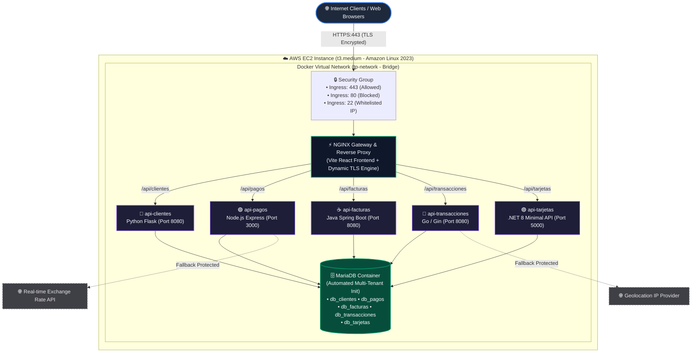

---

## 💻 Polyglot Microservices Stack

Each service was architected to leverage the ecosystem strengths of its target technology stack:

| Microservice | Technology & Runtime | Container Architecture | Responsibility & Domain | Registry Image |
|---|---|---|---|---|
| **`web`** | Vite + React + NGINX (Alpine) | Multi-stage (`node:20-alpine` ➔ `nginx:alpine`) | Single Page Application (SPA), routing gateway, TLS termination | [`maxiescgit/web:1.0.1`](https://hub.docker.com/r/maxiescgit/web) |
| **`api-clientes`** | Python 3.11 / Flask | Multi-stage (`python:3.11-slim`), non-root `appuser` | Customer management, identity profiles, contact registry | [`fededlv/api-clientes:1.0.0`](https://hub.docker.com/repository/docker/fededlv/api-clientes/general) |
| **`api-pagos`** | Node.js 20 / Express | Lightweight Debian-slim runtime | Payment processing, external FX conversion, transaction auditing | [`fededlv/api-pagos:1.0.0`](https://hub.docker.com/repository/docker/fededlv/api-pagos/general) |
| **`api-facturas`** | Java 17 / Spring Boot | Multi-stage Maven build ➔ Lightweight JRE | Invoice generation, tax calculation, billing records | [`maxiescgit/api-facturas:1.0.0`](https://hub.docker.com/r/maxiescgit/api-facturas) |
| **`api-transacciones`** | Go 1.22 / Gin | Multi-stage Go compiler ➔ Minimal static runner | High-concurrency financial ledger, IP geolocation enrichment | [`maxiescgit/api-transacciones:1.0.1`](https://hub.docker.com/r/maxiescgit/api-transacciones) |
| **`api-tarjetas`** | C# / .NET 8 Minimal API | Multi-stage .NET SDK ➔ ASP.NET Core Runtime | Credit/debit card lifecycle, card tokenization, limits | [`franlopezmora/api-tarjetas:1.0.0`](https://hub.docker.com/r/franlopezmora/api-tarjetas) |
| **`db`** | MariaDB 11.x | Configured with `/docker-entrypoint-initdb.d` | Relational persistence across 5 isolated database schemas | [`franlopezmora/db:1.0.0`](https://hub.docker.com/r/franlopezmora/db) |

---

## ☁️ Cloud & Infrastructure Engineering

The platform was provisioned and validated on **AWS Cloud Infrastructure**:

- **Compute**: AWS EC2 `t3.medium` (2 vCPUs, 4 GiB RAM) running **Amazon Linux 2023** (x86_64).
- **Network & VPC Topology**:
  - Lab VPC with DNS resolution and DNS hostnames enabled.
  - Dedicated public subnet deployed across `us-east-1a`.
- **Zero-Trust Network Perimeter**:
  - **Inbound HTTPS (`443`)**: Open to `0.0.0.0/0` for global secure access.
  - **Inbound HTTP (`80`)**: **Completely blocked / closed** at the Security Group level to enforce encrypted transport.
  - **Inbound SSH (`22`)**: Strictly locked down to authorized administrative IP CIDR masks (`/32`).
- **Resource Governance (cgroups & namespaces)**:
  - Every container defines precise resource constraints in [`docker-compose.yml`](docker-compose.yml) (e.g., `cpus: "0.25" - "0.50"`, `memory: 128m - 512m`), preventing any rogue process or memory leak from starving adjacent microservices.

> Detailed hardware configuration, networking logs, and cloud security policies are documented in [AWS_EC2.md](AWS_EC2.md).

---

## 🛡️ DevSecOps & Hardening Highlights

```
+-----------------------------------------------------------------------------------+
|                            DEVSECOPS SECURITY MATRIX                              |
+------------------------------------+----------------------------------------------+
| Security Control                   | Implementation & Threat Mitigation           |
+------------------------------------+----------------------------------------------+
| 1. Least Privilege (Non-Root)      | Services (e.g. Python Flask) run as appuser  |
|                                    | to prevent container breakout & host takeover|
| 2. Runtime Ephemeral TLS           | Certificates generated on-the-fly at boot;   |
|                                    | 0 private keys committed to registry layers  |
| 3. Secret Isolation (.env)         | Excluded from git; synced via encrypted SCP  |
| 4. Attack Surface Minimization     | Multi-stage builds strip compilers & SDKs    |
| 5. Neighbor Isolation (cgroups)    | Memory & CPU quotas prevent host starvation  |
+------------------------------------+----------------------------------------------+
```

### 1. Rootless Container Execution
By default, Docker executes processes as `root`. If an attacker were to exploit a remote code execution vulnerability in an application, root privileges inside the container drastically increase the risk of container escape to the host.
In services like `api-clientes`, we implemented custom system users:
```dockerfile
RUN adduser --disabled-password --gecos '' appuser
WORKDIR /app
COPY --from=builder /opt/venv /opt/venv
COPY . .
RUN chown -R appuser:appuser /app
USER appuser
```

### 2. Runtime TLS Key Generation (Zero-Leakage Security)
Embedding SSL/TLS private keys inside a `Dockerfile` exposes sensitive cryptographic credentials to anyone pulling images from Docker Hub.
Instead, our reverse proxy uses an automated runtime `entrypoint.sh`:
- Generates private keys and certificates inside the container memory space only upon boot.
- Keys are written to a localized ephemeral container filesystem, ensuring that published Docker images remain completely credential-free.

### 3. Strict Secrets Management
- All database passwords, tokens, and connection strings are managed through segregated `.env` files in [`envs/`](envs/).
- Tracked strictly in `.gitignore`.
- Automated deployment scripts use secure SSH/SCP transfers to deliver configurations directly to the host instance without passing through version control.

---

## ⚡ Resilience & Fault Tolerance Patterns

Financial systems must remain operational even when upstream dependencies suffer disruptions:

### 1. Graceful Degradation on External API Failures
Both `api-pagos` and `api-transacciones` interact with third-party providers (exchange rates and IP-based geolocation).
- **Incident Experience**: During deployment, AWS public IPs were quickly rate-limited by the primary geolocation provider (`ipapi.co`).
- **Resilience Implementation**: Instead of throwing uncaught exceptions and aborting transaction writes, the microservices catch external timeouts and HTTP errors, gracefully defaulting the metadata (e.g., country left blank) while **successfully committing the core transaction to the database**.
- **Provider Redundancy**: The service was refactored to consume a more resilient provider (`ipwho.is`), ensuring seamless operational continuity.

### 2. Intelligent Cold-Start Smoke Testing
Java Spring Boot (`api-facturas`) has a longer JVM warmup and schema validation startup time than Go or Node.js.
- Rather than using static timeouts that fail prematurely, [`deploy.sh`](deploy.sh) integrates an **exponential retry polling strategy** (up to 12 attempts at 5-second intervals).
- The deployment only reports green once every microservice endpoint responds with HTTP `200 OK`.

---

## 🧠 Architectural Trade-Off Analysis (ADR)

### Trade-off 1: Multi-Tenant Database vs. Database-per-Service
* **Decision**: We deployed a single MariaDB instance running 5 isolated relational databases (`db_clientes`, `db_pagos`, `db_facturas`, `db_transacciones`, `db_tarjetas`).
* **Advantages**: Maximizes hardware efficiency on modest cloud instances (saving ~1.5 GB of RAM compared to running 5 separate database daemons) and drastically simplifies local setup.
* **Drawbacks & Mitigation**: Introduces a Single Point of Failure (SPOF) and shared I/O bottlenecks.
* **Production Path**: In enterprise production, this topology will transition to **AWS RDS Multi-AZ** or **Amazon Aurora Serverless**, giving each microservice its own managed database cluster with independent scaling and failover.

### Trade-off 2: Multi-Stage Containerization Strategy
* **Compiled Runtimes (Go, Java, .NET, Vite)**:
  - *Decision*: Compilers (Maven, Go SDK, .NET SDK, Node.js build tooling) are isolated in a build stage; only the compiled binary / static artifacts are copied into Alpine/Distroless runners.
  - *Impact*: Reduces image sizes by **80–90%**, accelerates deployment speed, and eliminates build tools from the production attack surface.
* **Interpreted Runtimes (Python, Node.js Backend)**:
  - *Decision*: Multi-stage builds isolate Python virtual environment wheel compilation (`pip install`), copying only the final `/opt/venv` into a slim runner with non-root privileges.

---

## 🚀 Automated Deployment & Runbook

### Prerequisites
- Local machine with `bash`, `ssh`, `scp`, `curl`, and `docker`.
- Running AWS EC2 instance with SSH key (`.pem`).
- Docker Hub account.

### 1. Clone the Repository
```bash
git clone https://github.com/fededlv/fintech-distributed-aws-platform.git
cd fintech-distributed-aws-platform
```

### 2. Build & Push All Images to Docker Hub
The build script automatically handles multi-stage compilation and image pushing across all 6 services:
```bash
chmod +x build_and_push.sh deploy.sh
./build_and_push.sh <YOUR_DOCKERHUB_USERNAME>
```

### 3. Automated Cloud Deployment (AWS EC2)
Execute the deployment script targeting your EC2 instance. The script will:
1. Verify SSH connectivity.
2. Automatically install Docker, Docker Compose, and configure daemon permissions on Amazon Linux 2023.
3. Synchronize environment files, database init scripts, and `docker-compose.yml` via SCP.
4. Pull the latest images from Docker Hub and start all containers in detached mode.
5. Run automated retry-based smoke tests against all HTTPS endpoints.

```bash
./deploy.sh <EC2_PUBLIC_IP> <PATH_TO_PRIVATE_KEY.pem>
```

```
=== Iniciando Deploy en EC2 (44.202.101.129) ===
--> Configurando Docker en Amazon Linux 2023...
--> Copiando archivos de entorno y docker-compose...
--> Pulleando imágenes y levantando el stack con Docker Compose...
--> Verificando estado de los servicios (Smoke Tests)...
Probando https://44.202.101.129/ ... [OK]
Probando https://44.202.101.129/api/clientes ... [OK]
Probando https://44.202.101.129/api/pagos ... [OK]
Probando https://44.202.101.129/api/facturas ... [OK]
Probando https://44.202.101.129/api/transacciones ... [OK]
Probando https://44.202.101.129/api/tarjetas ... [OK]
=================================================
¡Despliegue finalizado con éxito! Todo funcionando.
=================================================
```

---

## 📸 Verification & Production Gallery

<details open>
<summary><b>1. Running Containers on AWS EC2</b></summary>
<br/>

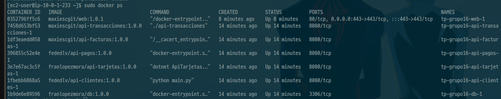
*All 7 containers operating with healthy status and bounded resource allocations.*
</details>

<details>
<summary><b>2. AWS EC2 Cloud Setup & Security Groups</b></summary>
<br/>

| Instance Summary | Security Group Configuration |
|---|---|
|  |  |

</details>

<details>
<summary><b>3. Automated CLI Deployment & Smoke Tests</b></summary>
<br/>

| Script Execution | Curl Verification via HTTPS |
|---|---|
| 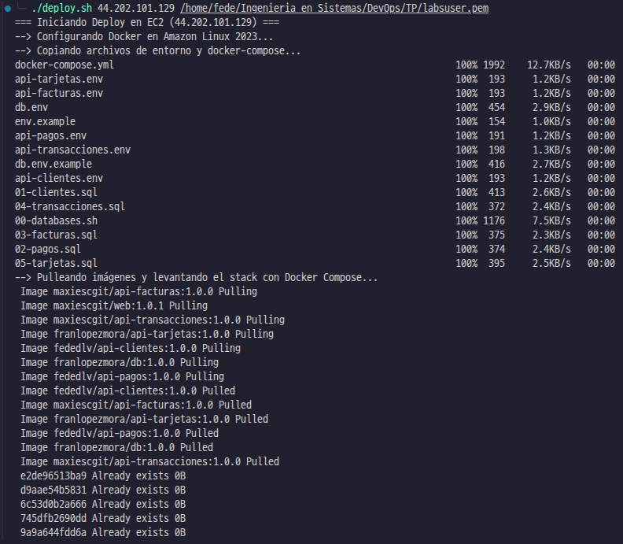 | 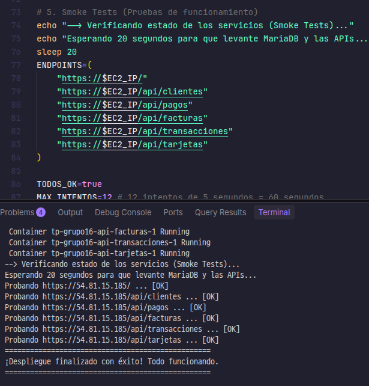 |

</details>

<details>
<summary><b>4. Functional Microservices Interfaces (Web Frontend)</b></summary>
<br/>

| Microservice | UI Preview |
|---|---|
| **Customers (`api-clientes`)** | 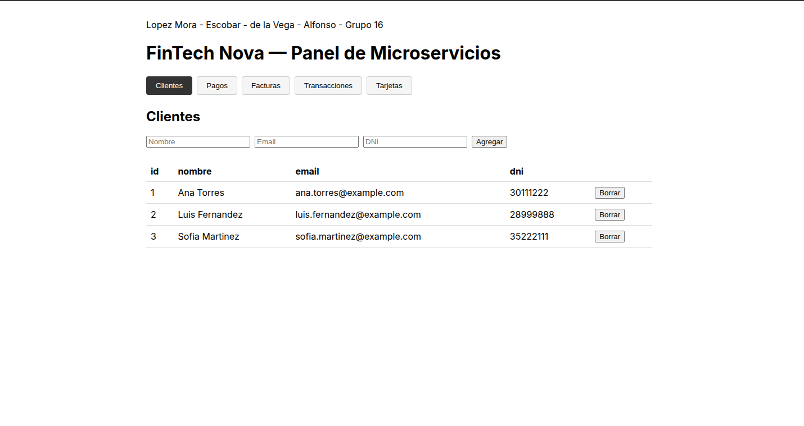 |
| **Payments (`api-pagos`)** | 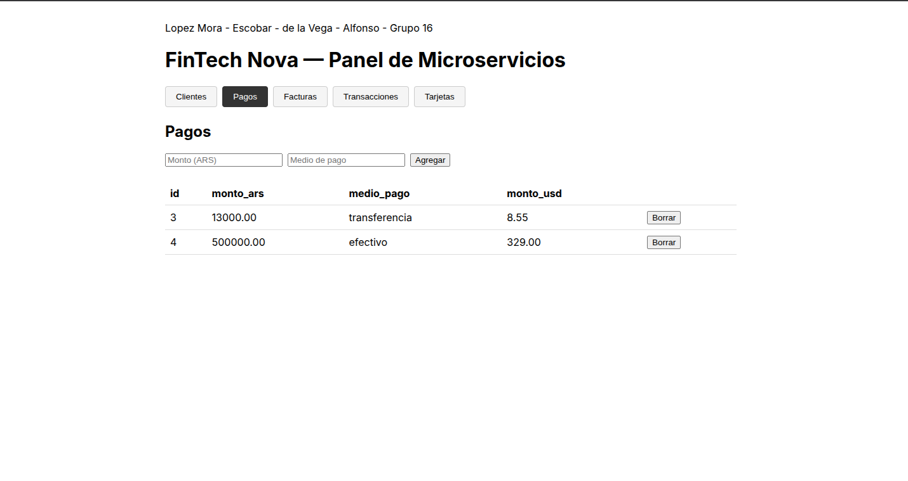 |
| **Invoices (`api-facturas`)** | 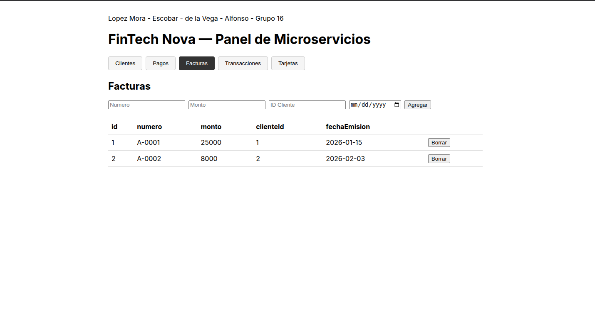 |
| **Cards (`api-tarjetas`)** | 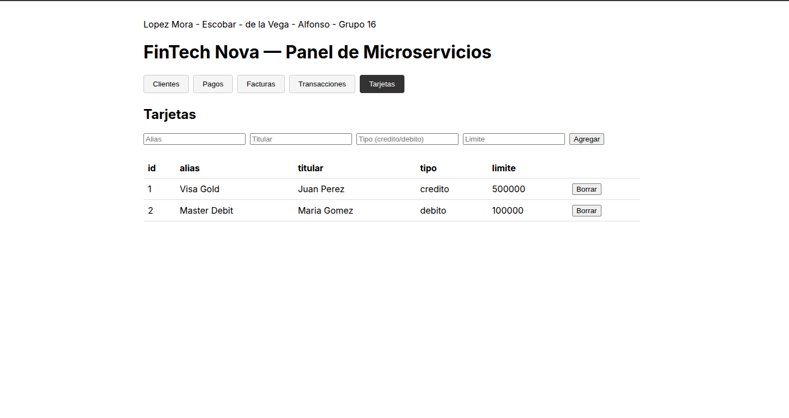 |
| **Transactions (`api-transacciones`)** | 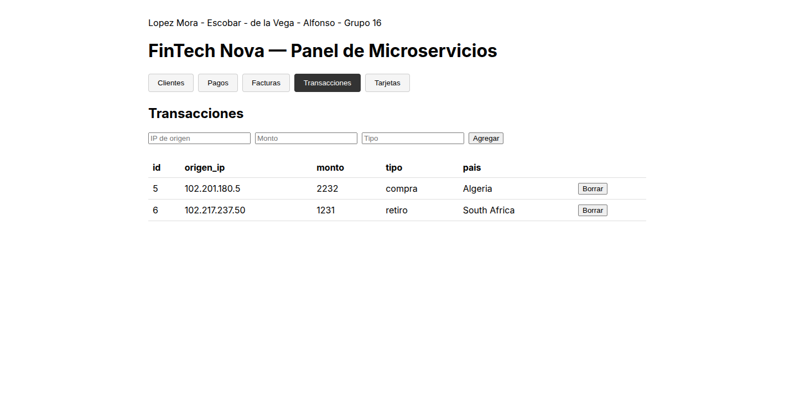 |

</details>

<details>
<summary><b>5. Docker Hub Repositories</b></summary>
<br/>

| Registries Part 1 | Registries Part 2 |
|---|---|
| 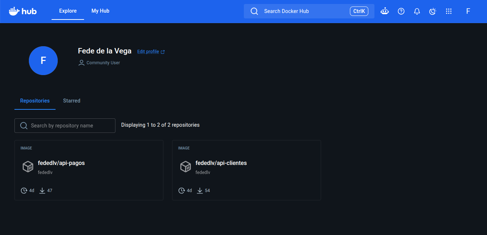 | 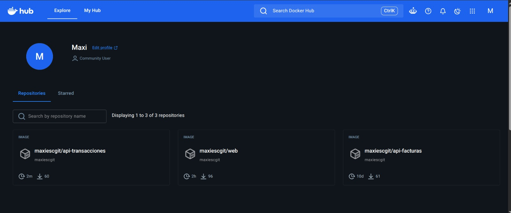 |

</details>

---

## 🗺️ Production Roadmap

To transition this platform to enterprise-scale production, the following enhancements are planned:

- [ ] **Automated CI/CD Pipelines**: Implement GitHub Actions workflows for automated linting, test suites, multi-arch Docker image builds, and automated staging deployments.
- [ ] **Public CA Certificates**: Integrate Let's Encrypt with Certbot or AWS Certificate Manager (ACM) behind an Application Load Balancer (ALB) to replace runtime self-signed certificates with trusted root CAs.
- [ ] **Managed Database Architecture**: Migrate the containerized MariaDB to **AWS RDS Multi-AZ** (or Amazon Aurora) to decouple storage, eliminate single points of failure, and provide automated snapshot backups.
- [ ] **Cloud Secret Management**: Transition `.env` file synchronization to **AWS Secrets Manager** or HashiCorp Vault with dynamic secret rotation.
- [ ] **Observability & Distributed Tracing**: Implement OpenTelemetry, Prometheus, and Grafana dashboards with Loki for centralized log aggregation.

---

## 👨‍💻 Author & Acknowledgments

**Federico Agustín de la Vega**  
*Cloud & DevOps Engineer | Software Developer*  
- **GitHub**: [@fededlv](https://github.com/fededlv)  
- **Docker Hub**: [fededlv](https://hub.docker.com/u/fededlv)  
- **LinkedIn**: [linkedin.com/in/federicodelavega](https://www.linkedin.com) *(Update with your direct LinkedIn profile handle)*

*Academic collaboration and co-authorship for initial modular components: Máximo Escobar, Francisco López Mora, Francisco Alfonso.*

---

<p align="center">
  <sub>Built with passion for cloud architecture, distributed systems, and modern DevOps practices.</sub>
</p>
