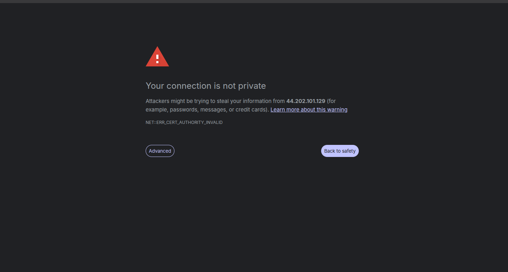

# 🛡️ Security & Hardening Specification — `web`

[](README.md)
[](README.md)

This document details the transport security, cryptographic key governance, and reverse proxy hardening controls implemented for the **Web Gateway & Frontend Application** (`web`).

---

## 🔒 Defensive Security Controls

### 1. Ephemeral Runtime TLS Key Generation (Zero-Leakage Architecture)
Embedding SSL/TLS private keys inside a `Dockerfile` during the image build permanently injects the private key into Docker image layers. Anyone who pulls the image from a public registry (such as Docker Hub) can extract the key, compromising transport encryption.

To guarantee **zero credential leakage**:
- Certificates and private keys are generated dynamically inside the container filesystem exclusively at startup via `entrypoint.sh`:
  ```sh
  #!/bin/sh
  mkdir -p /etc/nginx/ssl
  openssl req -x509 -nodes -days 365 -newkey rsa:2048 \
    -keyout /etc/nginx/ssl/key.pem \
    -out /etc/nginx/ssl/cert.pem \
    -subj "/CN=fintech-nova-gateway"
  nginx -t && exec nginx -g 'daemon off;'
  ```
- Keys reside only in ephemeral container memory and are never committed to version control or baked into image layers.


*Self-signed certificate generated dynamically at container runtime.*

---

### 2. Strictly Enforced HTTPS (Port 80 Disabled)
- Unencrypted HTTP (port 80) is not exposed anywhere in the stack.
- `nginx.conf` listens exclusively on port `443 ssl`.
- The AWS EC2 Security Group strictly rejects port 80 traffic. All web clients must communicate over encrypted TLS channels.

---

### 3. Server Header Obfuscation (`server_tokens off`)
To prevent reconnaissance attacks that fingerprint web server software and versions to locate known exploits, `nginx.conf` enforces:
```nginx
server_tokens off;
```
This strips version banners (e.g. `Server: nginx/1.25.x`) from all HTTP response headers.

---

### 4. Process Isolation & Unprivileged Workers
In `nginx:alpine`, worker processes execute under the dedicated unprivileged system account `nginx`. The master process requires root privileges solely during initial bootstrap to bind to privileged port `443`, immediately handing off request processing to unprivileged workers.

---

### 5. Multi-Stage Pipeline Hygiene
The Node.js compiler environment, npm modules, and developer build tools are discarded during compilation. The final NGINX production image contains only static HTML/JS/CSS assets and configuration files.

---

## 🛡️ Threat Model & Mitigation Matrix

| Threat Vector | Risk Level | Mitigation Strategy |
|---|---|---|
| **Private Key Extraction from Registry** | Critical | Runtime key generation via `entrypoint.sh`; keys never exist in Docker layers. |
| **Man-in-the-Middle (MitM) Eavesdropping** | High | Port 80 disabled; mandatory TLS encryption on port 443. |
| **Server Fingerprinting / Version Probing** | Low | `server_tokens off` hides NGINX version headers. |
| **Gateway Process Hijacking** | High | NGINX worker processes execute under unprivileged `nginx` system user. |
